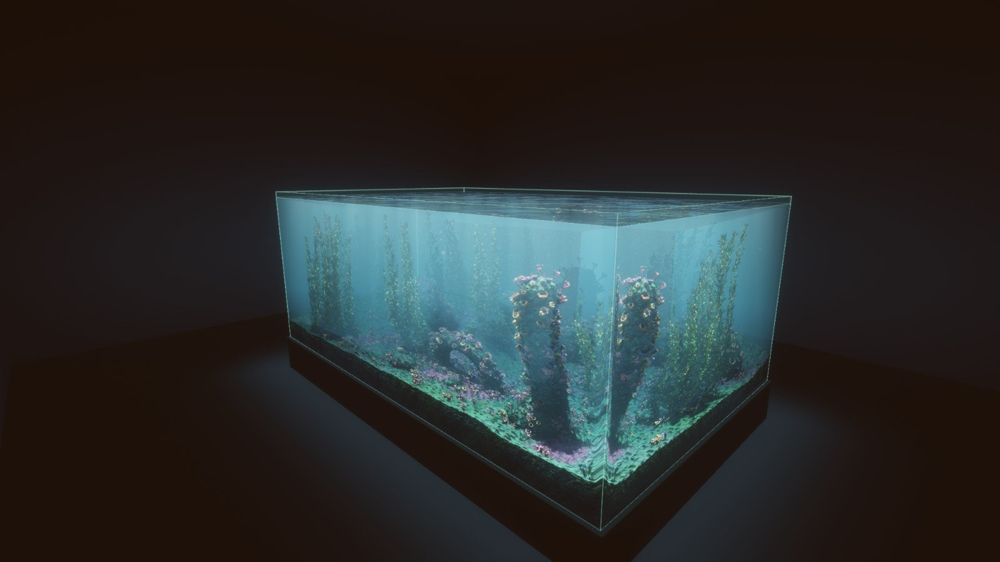
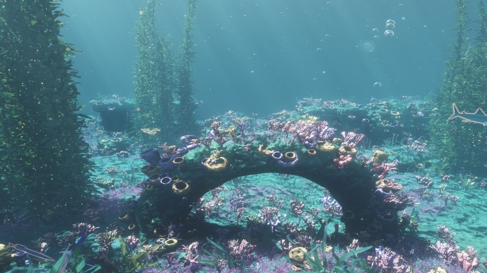
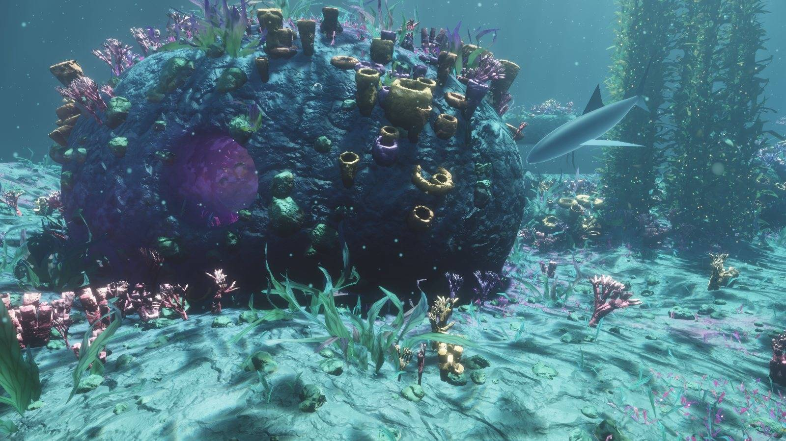
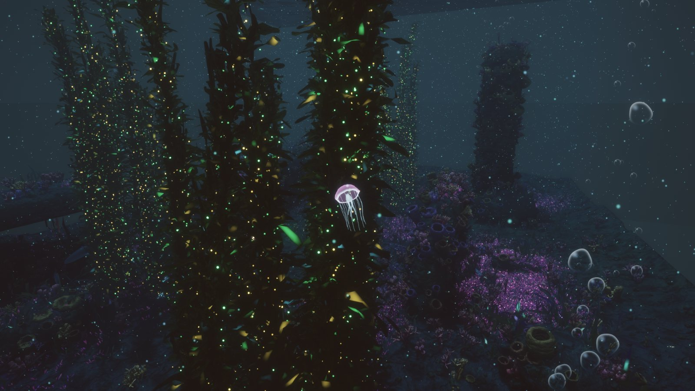
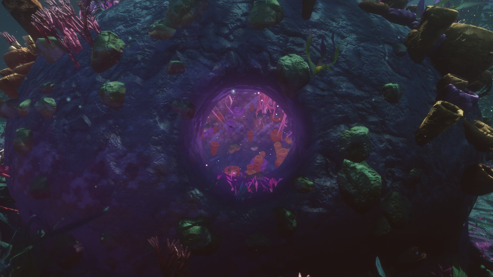
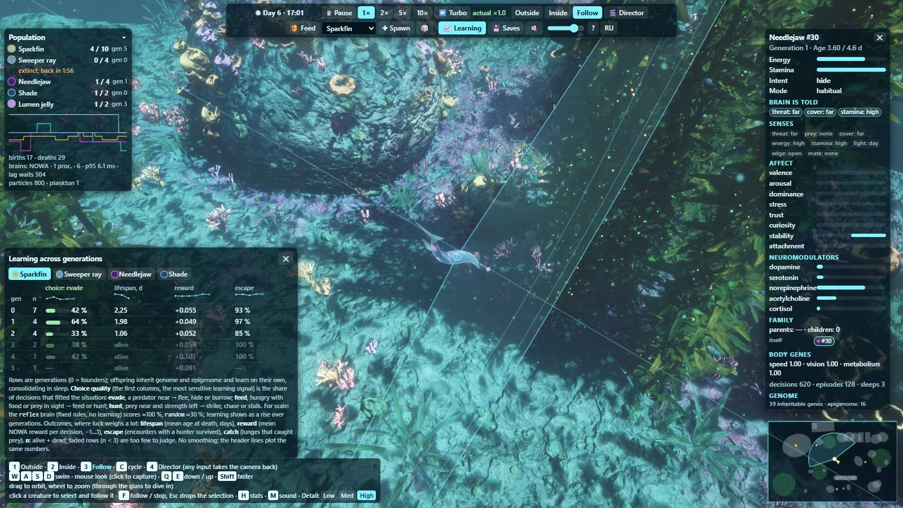
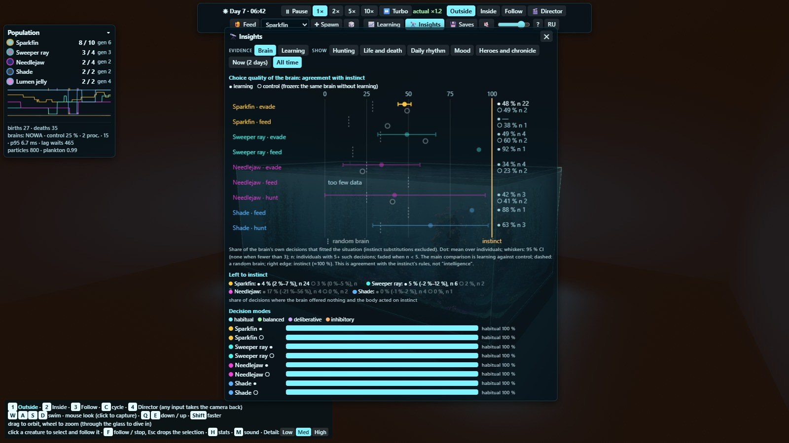
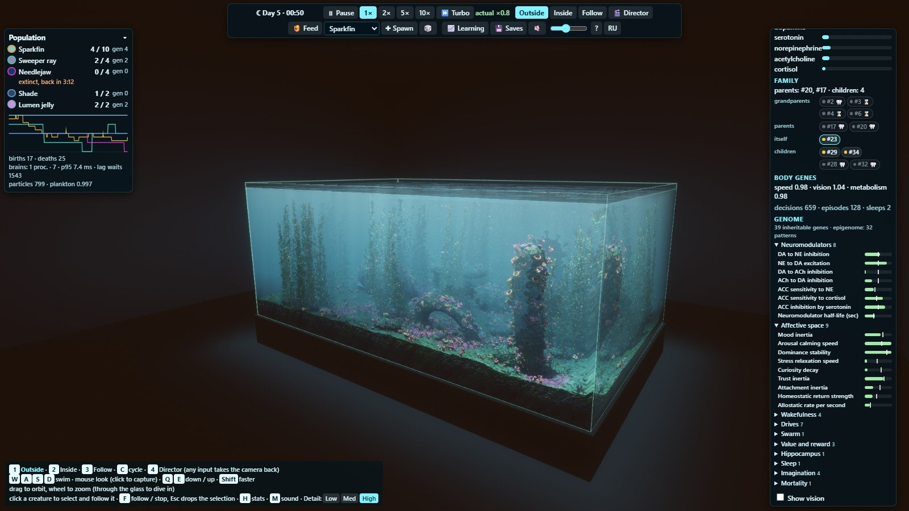

# NOWA Sea

A closed, self-sustaining aquarium in the browser. Fish, rays, eels and sharks are each driven by a full
[NOWA](https://github.com/burlakovmb/NOWA-Bio-Inspired-AI) cognitive core: they learn during life, consolidate in
sleep, breed, age and evolve over generations. The world is rendered with WebGPU in the style of
[abyssal-garden](https://github.com/Noniv/abyssal-garden). It can be fast-forwarded to 10x, saved and loaded like a game.

*Аквариум в браузере. Каждое существо управляется ядром NOWA: учится при жизни, закрепляет опыт во сне, размножается,
стареет и эволюционирует. Ниже — установка, запуск и устройство.*

| | |
|---|---|
|  |  |
|  |  |
|  |  |
|  |  |

Мир «вечный»: сервер автосохраняется каждые 15 минут симуляции и при остановке, а следующий запуск продолжает с того
же места. Новый мир — `--new`.

**Учится ли NOWA на самом деле — видно в самой игре.**
- Четверть особей каждого вида живёт с «замороженным» мозгом: то же ядро, гены и инстинкты, но без обучения и
  консолидации во сне.
- Панель 🔭 «Наблюдения» сравнивает их с обучающимися в одной воде:
  - качество собственных решений мозга;
  - различение контекста (прятаться, когда укрытие рядом, а не далеко);
  - изменение через сон.
- Отдельно — «шоу»: охота и цена укрытия, выживаемость, суточный распорядок, настроение и реакция на бросок, зал
  славы и хроника, карта присутствия.

Метрики разобрали три независимые модели; оговорки о малых выборках показаны на графиках.

## Требования

- Windows 10/11, Linux или macOS.
- Python 3.10+ и Git. Проверено на Python 3.14; на другой версии установка предупредит и продолжит.
- Node.js 18+ (сборка рендера).
- Браузер с WebGPU: Chrome или Edge 113+.
  - На ноутбуке с двумя видеокартами назначьте браузеру дискретную: «Параметры → Система → Дисплей → Графика →
    Chrome → Высокая производительность». Иначе WebGPU работает на встроенной.

## Самый простой способ (Windows)

Дважды щёлкните `NOWA-Sea.bat` в папке проекта.
- Первый запуск всё установит сам, это займёт несколько минут.
- Если не хватает Python, Git или Node.js, окно подскажет, где их скачать или какой командой `winget` поставить.
- Аквариум откроется в браузере. Пока смотрите, окно не закрывайте.
- Остановить и сохранить мир — `Ctrl+C` в этом окне.
- Следующие запуски продолжают тот же мир.

## Установка

PowerShell:

```powershell
scripts\setup.ps1
```

Linux и macOS:

```sh
scripts/setup.sh
```

Что делает установка:
1. Создаёт `.venv` и ставит зависимости Python.
2. Клонирует NOWA из репозитория автора в `vendor/nowa` на коммите из `nowa.lock`.
3. Прогоняет проверку совместимости NOWA с нашим хостом.
4. Собирает рендер в `renderer/dist/index.html`.

Версии закреплены на тех, с которыми проект проверен: NOWA — коммит из `nowa.lock`, пакеты Python — `constraints.txt`,
сборщик рендера — `renderer/package-lock.json`. Новая NOWA приходит только через `scripts/update-nowa` с проверкой
совместимости. Несовпадение — не ошибка, а предупреждение: на Python 3.10–3.11 или там, где закреплённые пакеты не
ставятся, установка берёт свежие совместимые. NOWA другой версии без вашего согласия не ставится: если закреплённого
коммита у автора больше нет, установка спросит, взять ли текущую версию (по умолчанию нет — тогда она остановится, и
NOWA останется прежней); без вопроса то же даёт `python scripts/nowa_tool.py fetch --allow-upstream`.

Если PowerShell запрещает скрипты, запустите `powershell -ExecutionPolicy Bypass -File scripts\setup.ps1`.

## Запуск

```powershell
scripts\run.ps1
```

```sh
scripts/run.sh
```

Сервер поднимается на http://127.0.0.1:8770/, открывает браузер и продолжает последний мир, если он есть.
Параметры передаются после `--`:

```powershell
scripts\run.ps1 -- --new --scale 0.25
```

| Параметр | Значение |
|---|---|
| `--new` | начать новый мир вместо продолжения автосохранения |
| `--scale` | доля целевой численности (1.0 — около 54 агентов NOWA и 6 медуз; 0.25 — щадящий режим); действует для нового мира, продолженный мир сохраняет свою |
| `--brain-workers` | процессы мозгов NOWA (по умолчанию 2 при `--scale` ≤ 0,5 и 5 при полной численности; см. «Нагрузка») |
| `--autosave-min` | автосохранение раз в N минут симуляции и при остановке (по умолчанию 15; 0 — выкл.) |
| `--load SLOT` | загрузить конкретный сейв |
| `--speed` | начальная скорость (1, 2, 5, 10) |
| `--brain` | `nowa` (по умолчанию); `reflex` и `random` — контрольные мозги без обучения для сравнения целых миров; `stub` — быстрые заглушки для отладки интерфейса |
| `--control-share` | доля «замороженной» контрольной касты NOWA в новом мире (по умолчанию 0,25; 0 — без касты) |
| `--demo` | только рендер со скриптовым движением, без мозгов |
| `--port`, `--host`, `--seed`, `--saves` | порт, адрес, сид мира, каталог сейвов (по умолчанию `./saves`) |

## Управление

| Клавиши, мышь | Действие |
|---|---|
| `1` / `2` / `3`, `C` | снаружи / внутри / следить, по кругу |
| `4` | режиссёр: камера сама облетает бак и переключается на охоту, поимку, рождение; любое действие возвращает управление |
| снаружи: перетаскивание, колесо | облёт и зум; зум через стекло — нырок внутрь |
| внутри: клик, мышь, `WASD`, `Q`/`E`, `Shift` | захват мыши, обзор, плыть, вниз / вверх, быстрее |
| клик по существу | выбрать и следить; инспектор показывает его мозг |
| `F`, `Esc` | перестать следить |
| `M`, `H` | звук, строка статистики |

Панель HUD:
- скорость времени (пауза, 1x–10x, турбо);
- сохранить и загрузить, экспорт и импорт файла сейва;
- численность по видам с графиком;
- корм, появление особи;
- настройки восстановления вымерших видов;
- **«Обучение»** — поколения каждого вида: срок жизни, награда за решение, уход от угроз или успех охоты и качество
  выбора;
- инспектор мозга выбранного существа с конусом обзора и мини-картой;
- язык RU/EN.

## Обновление NOWA

```powershell
scripts\update-nowa.ps1
```

```powershell
scripts\update-nowa.ps1 -Status
```

Скрипт берёт свежий коммит upstream (`main`) во временную папку и прогоняет на нём проверку совместимости:
- смоук хоста;
- сохранение и загрузку мозга с совпадением устойчивой памяти;
- рождение потомка;
- замер стоимости решения против базовой линии этой машины.

Только при успехе он переключает `vendor/nowa` и переписывает `nowa.lock`. При провале остаётся старая версия и
печатается отчёт. Весь доступ к NOWA идёт через `nowasea/brains/nowa_adapter.py`, поэтому изменение API чинится там.

## Тесты

```powershell
.venv\Scripts\python.exe -m pytest -q
```

```powershell
.venv\Scripts\python.exe -m nowasea.tools.soak --scale 0.25 --workers 2 --speed 10 --minutes 10
```

Первая команда — автотесты. Что они проверяют:
- видимость перекрывается скалой;
- расщелина пропускает искорку и не пропускает тень;
- хищник теряет добычу в гроте (20 прогонов);
- вымирание вида запускает таймер и группу-основателя;
- сохранение и загрузка мира с совпадением тел и устойчивой памяти NOWA;
- автосохранение при остановке и продолжение мира при следующем запуске;
- сводка обучения по поколениям;
- поток WebSocket.

Вторая команда — длительный прогон без браузера. Он печатает:
- достигнутую скорость;
- p50/p95 стоимости решения;
- ожидания на мозгах;
- память;
- численность и поколения.

## Нагрузка

Замер на ноутбуке i7-12700H (14 ядер), уже занятом другой работой на 30–50 %. Прогон
`python -m nowasea.tools.soak`, 10 минут реального времени:

| Состав | Процессы мозгов | Достигнутая скорость | p95 решения | Память |
|---|---|---|---|---|
| `--scale 0.25` (~15–35 существ) | 2 | 9,7x (задано 10x) | 9–12 мс | сервер 55 МБ, процесс мозгов ~90 МБ |
| `--scale 1.0` (~60–78 существ) | 5 | 8,9x в среднем за прогон (с запуском), ~10x в устоявшемся режиме | 10 мс в среднем, пики до 25 | сервер ~58 МБ, процесс мозгов — плато ~83 МБ после первого часа симуляции (+1,5 %) |

Прогон приёмки — 2 часа реального времени, полный состав, 5 процессов, машина занята другой работой на ~45 %:
- 18,2 ч симуляции, средняя скорость 9,1x, кратковременная просадка до 0,6x;
- p95 решения: медиана 8,2 мс, максимум 20 мс;
- память процессов мозгов после первого часа +7 % (критерий ≤ 10 %), сервер ~64 МБ;
- без сбоев; 1636 рождений, искорки дошли до 55-го поколения;
- скаты и тени вымирали и были восстановлены автоматически.

Если мозги не успевают, мир притормаживает сам, и HUD показывает фактическую скорость оранжевым.

## Устройство

```
browser (renderer/)  <── binary WebSocket ──>  Python server (nowasea/)
  WebGPU, камеры, HUD                            simulation thread, fixed dt = 0.05 s
                                                 ├─ world/      бак (SDF + сетка расстояний), видимость, коллизии
                                                 ├─ ecosystem/  виды, планктон, частицы, жизнь, размножение, эволюция
                                                 ├─ brains/     адаптер NOWA, пул процессов, проверка совместимости
                                                 ├─ persistence/ сейвы (zip: мир + все мозги .nowa)
                                                 └─ server/     aiohttp, протокол, поток симуляции
```

Принципы:
- Python — единственный владелец состояния, браузер только рисует.
- NOWA выбирает **намерение** (кормиться, бежать, прятаться, охотиться…) по событию: когда меняются сенсорные
  токены, но не чаще 0,75 с и не реже 4 с симуляции. Моторный слой исполняет намерение непрерывно.
- Если мозги не успевают, мир притормаживает, и HUD показывает достигнутую скорость.

Документы:
- [docs/PROMPT.md](docs/PROMPT.md) — постановка;
- [docs/species.md](docs/species.md) — виды и внешний вид;
- [docs/protocol.md](docs/protocol.md) — протокол и SDF бака;
- [docs/nowa-host-guide.md](docs/nowa-host-guide.md) — как встроить NOWA в любой мир (контракт, бюджет, ловушки).

## Участие

Правки принимаются только через pull request: сделайте fork, внесите изменение и откройте PR. В основную ветку оно
попадёт после ревью и одобрения владельца. Ошибки и предложения — в issues.

## Лицензии

Код этого репозитория — MIT ([LICENSE](LICENSE)). Рендер — форк abyssal-garden (MIT).

NOWA сюда **не входит**. Её лицензия (PolyForm Strict 1.0.0) запрещает распространение, изменение и производные работы
без разрешения автора, поэтому `scripts/setup` скачивает её из репозитория автора. Перед публикацией или раздачей
сборок согласуйте использование с автором. Подробности — [THIRD_PARTY_NOTICES.md](THIRD_PARTY_NOTICES.md).
